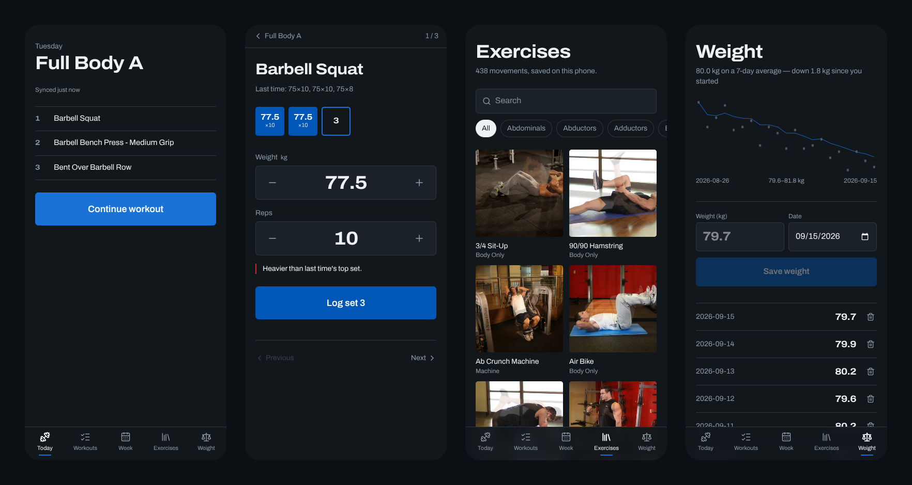
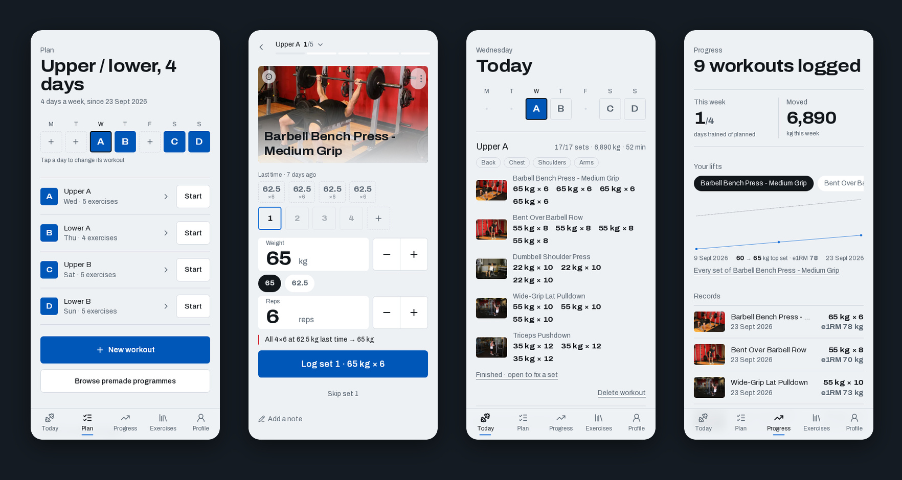

# gymlog

[](https://github.com/iloire/gymlog/actions/workflows/ci.yml)
[](https://gymlog-pi-eosin.vercel.app)

Build your workouts, put them on the days you train, then log the weight and reps you actually
did — **with or without signal**. Made for a gym in a basement.



Dark in a basement, light at a desk by a window — the same app in its light theme: the week on
Plan, a set going in, the workout just finished, and progress.



The CI badge is green only when a commit's **unit tests pass, it builds, and that same commit
deployed to production** — the workflow waits for Vercel's verdict and smoke-tests the live site.

## What it does

- **Premade programmes**, fitted to the equipment you have
- **Progression** — the next set's weight and reps, with the reason
- **873 exercises** with photos
- **Theme support**
- **API for LLMs** — OpenAPI schema at `/api/v1/openapi.json`

## Works offline

Every screen reads from IndexedDB on the device, never from the network, and a sync engine
pushes and pulls in the background. Log a whole session in airplane mode; it reaches the server
when signal comes back, exactly once. How that holds together — the outbox, last-write-wins per
row, deterministic ids, parents-first applies — is in
[`docs/architecture.md`](docs/architecture.md).

## Stack

Next.js 16 (App Router) · TypeScript strict · Tailwind v4 + shadcn/ui · Drizzle + Turso (libSQL) ·
NextAuth v5 · Dexie · Vitest · Vercel

## Getting started

Env files are not in git. Copy the template and fill in an `AUTH_SECRET`; a local SQLite file
needs nothing else:

```bash
cp .env.example .env.local   # TURSO_DATABASE_URL="file:./local.db", AUTH_SECRET=$(openssl rand -base64 32)
npm install
npm run db:migrate     # local SQLite at ./local.db
npm run db:seed        # the exercise library
npm run dev            # http://localhost:3000
```

## Scripts

| Command | |
|---|---|
| `npm run dev` | Dev server |
| `npm test` | Unit tests (Vitest) |
| `npm run build` | Lint, typecheck, then `next build` — what CI and Vercel run |
| `npm run db:generate` | New migration from `db/schema.ts` |
| `npm run db:migrate` / `db:migrate:prod` | Apply migrations to local / production |
| `npm run db:seed` / `db:seed:prod` | Load the exercise library |
| `npm run exercises:import` | Re-import the library from free-exercise-db |
| `npm run user:role -- <email> admin` / `user:role:prod` | Grant (or with `user`, revoke) access to `/admin` |

## Testing offline

Use a production build — under `next dev` the service worker serves stale hot-reload chunks and
misleads you either way:

```bash
npm run build && npx next start -p 3001
```

Then turn the network off in DevTools. On a phone, test against the deployed site: service
workers and the screen wake lock only run over HTTPS.

## Docs

- [`docs/architecture.md`](docs/architecture.md) — sync protocol and the offline design
- [`docs/design-system.md`](docs/design-system.md) — the plate-colour palette and type
- [`docs/env.md`](docs/env.md) — environment variables
- [`docs/plan.md`](docs/plan.md) — the build plan and what is still to do
- [`CHANGELOG.md`](CHANGELOG.md)

## Credits

Exercise data and photos: [yuhonas/free-exercise-db](https://github.com/yuhonas/free-exercise-db),
released into the public domain under the Unlicense.

## License

[MIT](LICENSE). The exercise data keeps its own Unlicense (public domain).
